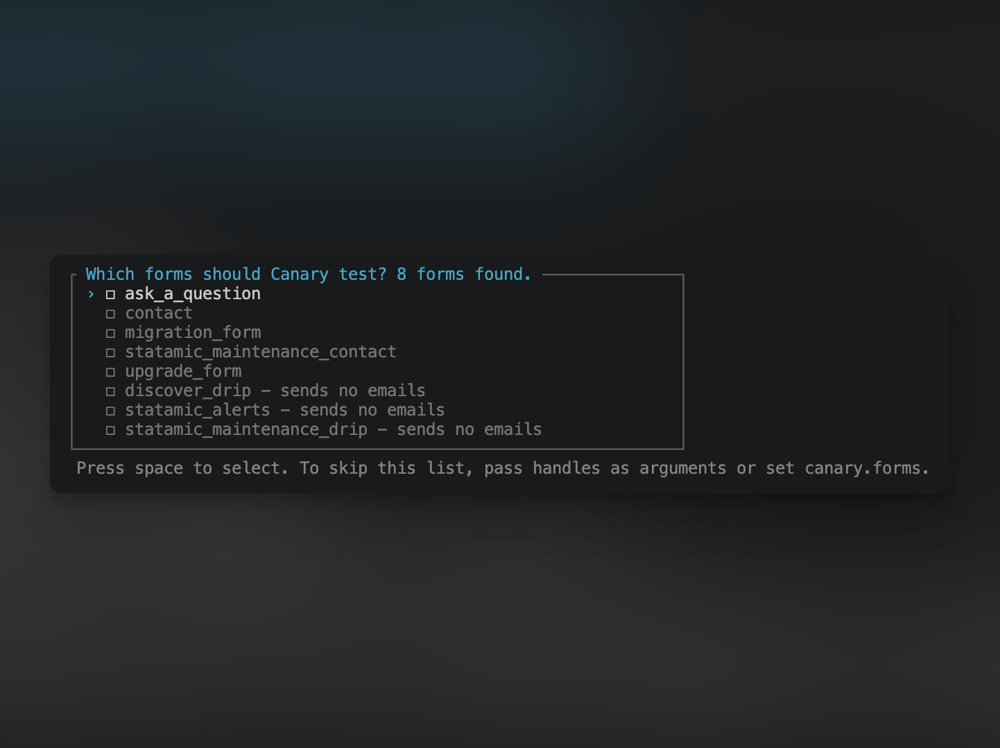

# Canary by D3 Creative

**Check a Statamic site's form emails still send, without saving a submission or emailing the client.**

The usual way to check a live form is to submit it. That saves a submission, signs the address up to newsletters, creates a lead in the CRM and emails the client's staff, who then ask what happened.

Canary sends a form's **real** emails (its own template, subject, from address and mailer) to **one test address**, through the **real queue**. It doesn't save a submission or run the form's listeners, so newsletter and CRM integrations never see it.

```bash
php artisan canary:forms contact quote --to=you@example.com
```

If the emails arrive, the templates, sender, mail provider and queue worker are all working.



## Installation

```bash
composer require d3creative/statamic-canary
```

Requires Statamic 6 and PHP 8.3+.

## Usage

```bash
php artisan canary:forms {forms?*} {--to=} {--site=} {--pick}
```

| | |
|---|---|
| `forms` | Handles of the forms to test. |
| `--to` | The address that receives every test email. |
| `--site` | Handle of the site to send as, on a multisite. Defaults to the default site. |
| `--pick` | Choose forms from the list, even if some are saved or configured. |

### Picking forms from a list

If you run `canary:forms` with no handles, Canary lists every form on the site and you tick the ones to test. Forms that send no emails are listed last, since there's nothing for Canary to test in them. It never tests every form on its own: many sites have test forms or newsletter-only forms you won't want to send.

After you pick, Canary asks whether to save your choice. If you say yes, later runs test the saved forms without showing the list, including non-interactive runs such as deploy scripts. Run `canary:forms --pick` to choose again.

Saved forms are stored in `resources/addons/statamic-canary.yaml`. Save them on your local copy and commit the file, so every environment tests the same forms.

### Setting defaults

To set the test address, publish the config:

```bash
php artisan vendor:publish --tag=canary-config
```

Then add it to `.env`:

```env
CANARY_TO=you@example.com
```

Now `php artisan canary:forms` needs no options at all.

You can also list the forms in `config/canary.php` instead of saving them from the list:

```php
'forms' => ['contact', 'quote'],
```

Canary uses the first of these that gives it any forms: handles passed as arguments, then `canary.forms`, then the saved forms, then the list. With none of them, a non-interactive run (a deploy script, or `--no-interaction`) fails, because it can't show the list.

### What you'll get

For each form, Canary builds an unsaved submission filled with sample values from the form's blueprint, then sends each of the form's emails with these changes:

- `to` is your test address.
- The subject starts with `TEST: `.
- `cc` and `bcc` are removed.

Everything else, including the template, `from`, `reply_to` and `mailer`, is unchanged. Email fields are filled with your test address, so automatic replies to the visitor come back to you too. Text fields get `Test`, so a subject like `{{ full_name }} submitted the contact form.` arrives as "TEST: Test submitted the contact form."

Nothing is saved. The form's real recipients are only changed in memory and never written back.

### Exit codes

The command exits non-zero if a form doesn't exist or its emails fail to dispatch, so a deploy script can stop. A form with no emails shows a warning but doesn't fail the run.

If the queue connection is `sync`, Canary warns you: the templates and sender are tested, but no queue worker is.

## What Canary doesn't check

- **Form listeners.** Newsletter, CRM and other integrations listen for `FormSubmitted` and `SubmissionCreated`. Canary skips both events on purpose, so it can't tell you whether those integrations work.
- **Validation.** Sample values only need to render in a template. Canary tests the email path, not the form.
- **The inbox.** Canary proves the email jobs were dispatched. Checking that they arrived is up to you.

A scheduled mode that alerts you when a form stops sending, and a Control Panel page, aren't in this version yet.

## Canary and Mailables Viewer

[Mailables Viewer](https://github.com/statamic/mailables-viewer) previews your app's mailables in the Control Panel. It doesn't find form emails on its own, and it renders them without the form's template, subject or from address, using the first stored submission it finds. It also sends without going through the queue.

Canary uses each form's own settings and sample data from its blueprint, sends through the queue, and runs from the command line, so it fits a maintenance checklist or a deploy script. The two work well together.

## Support

Canary is maintained by [D3 Creative](https://d3creative.uk). Report bugs or ask questions in [GitHub issues](https://github.com/d3creativeuk/statamic-canary/issues). For enquiries about managed Statamic maintenance, visit [d3creative.uk/services/statamic-maintenance](https://d3creative.uk/services/statamic-maintenance).

## License

MIT. See [LICENSE](LICENSE).
