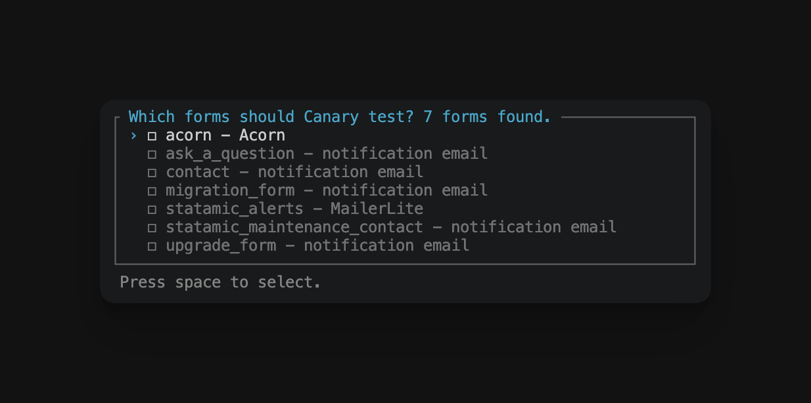

# Canary by D3 Creative

**Check a Statamic site's form emails still send, without saving a submission or emailing the client.**

The usual way to check a live form is to submit it. That saves a submission, signs the address up to newsletters, creates a lead in the CRM and emails the client's staff, who then ask what happened.

Canary sends a form's **real** emails (its own template, subject, from address and mailer) to **one test address**, through the **real queue**. It doesn't save a submission or run the form's listeners, so newsletter and CRM integrations never see it, and it never changes the form itself.

```bash
php artisan canary:forms contact quote --to=you@example.com
```

If the emails arrive, the templates, sender, mail provider and queue worker are all working.

Canary can also check a form's integrations, such as MailerLite or ActiveCampaign, without adding anyone to them. See [Checking integrations](#checking-integrations).


## Installation

```bash
composer require d3creative/statamic-canary
```

Requires Statamic 6 and PHP 8.3+.

## Usage

```bash
# Pick forms from a list, and optionally save them for next time
php artisan canary:forms --to=you@example.com

# Test the contact and quote forms
php artisan canary:forms contact quote --to=you@example.com

# Choose again, ignoring the saved forms
php artisan canary:forms --pick

# Send as the French site on a multisite
php artisan canary:forms contact --site=fr

# Also add the test address to each integration, then delete it
php artisan canary:forms newsletter --subscribe
```

The examples without `--to` assume `CANARY_TO` is set. See [Setting defaults](#setting-defaults).

| | |
|---|---|
| `forms` | Handles of the forms to test. |
| `--to` | The address that receives every test email. |
| `--site` | Handle of the site to send as, on a multisite. Defaults to the default site. |
| `--pick` | Choose forms from the list, even if some are saved or configured. |
| `--subscribe` | Also add the test address through each integration, then delete it. See [Subscribing a test contact](#subscribing-a-test-contact). |

### Picking forms from a list

If you run `canary:forms` with no handles, Canary lists every form on the site and you tick the ones to test. Each form shows what Canary will test in it:

```
contact - emails
statamic_alerts - emails, MailerLite
newsletter - MailerLite
old_form - no emails or integrations found
```

Forms with nothing to test are listed last. Canary never tests every form on its own: many sites have test forms you won't want to send.



After you pick, Canary asks whether to save your choice. If you say yes, later runs test the saved forms without showing the list, including non-interactive runs such as deploy scripts. Run `canary:forms --pick` to choose again.

Saved forms are stored in `resources/addons/statamic-canary.yaml`. Save them on your local copy and commit the file, so every environment tests the same forms.

### Setting defaults

To set the test address, publish the config:

```bash
php artisan vendor:publish --tag=canary-config
```

Then add it to `.env`:

```env
CANARY_TO=you@example.com
```

Now `php artisan canary:forms` needs no options at all.

You can also list the forms in `config/canary.php` instead of saving them from the list:

```php
'forms' => ['contact', 'quote'],
```

Canary uses the first of these that gives it any forms: handles passed as arguments, then `canary.forms`, then the saved forms, then the list. With none of them, a non-interactive run (a deploy script, or `--no-interaction`) fails, because it can't show the list.

### What you'll get

For each form, Canary builds an unsaved submission filled with sample values from the form's blueprint, then sends each of the form's emails with these changes:

- `to` is your test address.
- The subject starts with `TEST: `.
- `cc` and `bcc` are removed.

Everything else, including the template, `from`, `reply_to` and `mailer`, is unchanged. Email fields are filled with your test address, so automatic replies to the visitor come back to you too. Text fields get `Test`, so a subject like `{{ full_name }} submitted the contact form.` arrives as "TEST: Test submitted the contact form."

These changes are made to a copy of the form's settings in memory, never to the form itself. See [Canary doesn't change your site](#canary-doesnt-change-your-site).

### Exit codes

The command exits non-zero if a form doesn't exist, its emails fail to dispatch or an integration check fails, so a deploy script can stop. A form with nothing to test shows a warning but doesn't fail the run.

If the queue connection is `sync`, Canary warns you: the templates and sender are tested, but no queue worker is.

## Checking integrations

Newsletter and CRM integrations are usually listeners on `FormSubmitted`. A listener decides which forms it handles in its own code, so Canary can't tell from outside which forms reach MailerLite. Running the listener to find out would add a real contact.

For the full check, a listener tells Canary about itself through a few plain methods. Canary looks for them by name, so the listener never depends on Canary, and removing Canary never breaks it. Without them, Canary reads the listener's code instead and can check less. See [Without the methods](#without-the-methods).

| Method | What it does |
|---|---|
| `canaryForms(): array` | Each form the listener handles, and the fields it reads: `['contact' => ['email']]`. |
| `canaryName(): string` | The name shown in the list and the output, such as `MailerLite`. Defaults to the class name. |
| `canaryCheck(string $form): void` | A read-only API call that throws if something's wrong, such as a bad API key or a deleted list. |
| `canaryContact(string $form, string $email): ?string` | The ID of the contact with this email address, or `null`. Only needed for `--subscribe`. |
| `canaryDelete(string $form, string $id): void` | Deletes that contact. Only needed for `--subscribe`. |

### MailerLite example

For a listener that uses the [MailerLite PHP SDK](https://github.com/mailerlite/mailerlite-php) and sends each form to a group:

```php
use MailerLite\Exceptions\MailerLiteHttpException;
use MailerLite\MailerLite;
use Statamic\Events\FormSubmitted;

class MailerLiteSubscriber
{
    // Form handle => MailerLite group ID
    protected array $groups = [
        'newsletter' => '1234567890',
        'statamic_alerts' => '0987654321',
    ];

    public function handle(FormSubmitted $event) { /* adds the subscriber to the form's group */ }

    public function canaryName(): string
    {
        return 'MailerLite';
    }

    public function canaryForms(): array
    {
        return array_map(fn () => ['email'], $this->groups);
    }

    public function canaryCheck(string $form): void
    {
        // Throws if the API key is wrong or the group has gone.
        $this->mailerLite()->groups->find($this->groups[$form]);
    }

    public function canaryContact(string $form, string $email): ?string
    {
        try {
            return $this->mailerLite()->subscribers->find($email)['body']['data']['id'] ?? null;
        } catch (MailerLiteHttpException $e) {
            if ($e->getCode() === 404) {
                return null;
            }

            throw $e;
        }
    }

    public function canaryDelete(string $form, string $id): void
    {
        $this->mailerLite()->subscribers->delete($id);
    }

    private function mailerLite(): MailerLite
    {
        return new MailerLite(['api_key' => config('services.mailerlite.api_key')]);
    }
}
```

### ActiveCampaign example

For a listener that calls the [ActiveCampaign API](https://developers.activecampaign.com/reference/overview) with Laravel's HTTP client and adds each form to a list:

```php
use Illuminate\Http\Client\PendingRequest;
use Illuminate\Support\Facades\Http;
use Statamic\Events\FormSubmitted;

class ActiveCampaignSubscriber
{
    // Form handle => ActiveCampaign list ID
    protected array $lists = [
        'contact' => 3,
        'newsletter' => 7,
    ];

    public function handle(FormSubmitted $event) { /* adds the contact to the form's list */ }

    public function canaryName(): string
    {
        return 'ActiveCampaign';
    }

    public function canaryForms(): array
    {
        return array_map(fn () => ['email'], $this->lists);
    }

    public function canaryCheck(string $form): void
    {
        // Throws if the API key is wrong or the list has gone.
        $this->activeCampaign()->get("/api/3/lists/{$this->lists[$form]}")->throw();
    }

    public function canaryContact(string $form, string $email): ?string
    {
        return $this->activeCampaign()->get('/api/3/contacts', ['email' => $email])->throw()->json('contacts.0.id');
    }

    public function canaryDelete(string $form, string $id): void
    {
        $this->activeCampaign()->delete("/api/3/contacts/{$id}")->throw();
    }

    private function activeCampaign(): PendingRequest
    {
        return Http::baseUrl(config('services.activecampaign.url'))
            ->withHeaders(['Api-Token' => config('services.activecampaign.key')])
            ->acceptJson();
    }
}
```

`services.activecampaign.url` is your account's API URL, such as `https://youraccount.api-us1.com`, from **Settings → Developer** in ActiveCampaign. If a form adds contacts to an automation rather than a list, check the automation in `canaryCheck()` with `GET /api/3/automations/{id}` instead.

ActiveCampaign automations often notify the client's staff, for example by emailing their sales team when someone fills in the contact form. Deleting the test contact afterwards doesn't take that email back, so don't run `--subscribe` on a site like that.

One listener can handle many forms, and one form can have several listeners. Canary checks each listener for each form.

### Without the methods

Canary never adds these methods for you: it doesn't change your code. Without them, Canary reads the listener's code to find the forms it handles, so a site works out of the box. It recognises the usual ways a listener picks its forms:

```php
if ($event->submission->form()->handle() == 'contact')
if (in_array($event->submission->form()->handle(), ['contact', 'quote']))
if ($submission->form()->handle() !== config('acorn.form'))
$groupId = $this->groups[$event->submission->form()->handle()] ?? null;
```

It also finds the fields a listener reads (`$submission->email` or `$submission->get('email')`) when it handles a single form, and the service's name when the code mentions one, such as ActiveCampaign or MailerLite. The list then shows:

```
contact - emails, ActiveCampaign (no API check)
```

That's enough to check the listener is registered and the form still has its fields. The API check needs `canaryCheck()`, because only the listener knows the API key and the list. If Canary can't work out a listener's forms at all, every run starts with a warning naming it:

```
WARN  Canary can't tell which forms App\Listeners\ActiveCampaignSubscriber handles. See https://github.com/d3creativeuk/statamic-canary#checking-integrations.
```

Listeners from a package and closure listeners get their own warning, since you can't add methods to them.

For each integration on a form, a normal run checks that:

1. **The listener is registered** for `FormSubmitted` or `SubmissionCreated`. Canary also looks through `app/Listeners` for classes with the Canary methods, so a listener someone has removed from `EventServiceProvider` is reported, not missed.
2. **The form still has the fields** the listener reads. This catches a field renamed in the Control Panel.
3. **The API still answers.** `canaryCheck()` can confirm the API key works and the list or group still exists.

None of these write anything to the service, so it's safe to run as often as you like.

```
INFO   1 email(s) for statamic_alerts dispatched to you@example.com.
INFO   statamic_alerts: MailerLite check passed.
ERROR  newsletter: MailerLite check failed: [url] /api/groups/1234567890 [http method] GET [status code] 404 [reason phrase] Not Found.
```

### Subscribing a test contact

`--subscribe` also tests the listener's own code, by sending it a test submission. For each integration with `canaryContact()` and `canaryDelete()`, Canary:

1. Checks your test address isn't already a contact. If it is, Canary stops, because deleting it afterwards would remove a real subscription. Use a `--to` address that isn't a contact.
2. Runs **that listener alone** with an unsaved submission. Other listeners don't run, and the submission can't be saved, even if the listener tries. Email fields get your test address, and text fields get "TEST form submission", so anyone looking at the service can see it's a test.
3. Checks the contact arrived, then deletes it.

If the delete fails, Canary prints the contact's ID so you can delete it by hand.

Deleting the contact doesn't undo what happened when it was added. If the list or group starts an automation, it may already have sent its first email to your test address, notified someone, or called a webhook. Check a site's automations before the first `--subscribe` run. A listener with its own rate limit may also ignore a second run within a short time; Canary reports that the contact never arrived.

## Canary doesn't change your site

Canary never edits your forms, templates, config or content.

- **Form settings.** Canary loads the form and swaps the recipients on that loaded copy, in memory, for the length of the run. The form's file is never written, so the next real submission goes to the real recipients as usual.
- **Submissions.** None are saved, even for forms that store submissions or accept file uploads.
- **Integrations.** `FormSubmitted` and `SubmissionCreated` aren't fired, so newsletter, CRM and other form listeners don't run. Integration checks are read-only. Only `--subscribe` adds anything to a service, and it deletes the contact afterwards.

The only file Canary writes is `resources/addons/statamic-canary.yaml`, and only when you choose to save your picked forms.

### What could still email someone else

Canary controls the recipients it hands to Statamic. Anything that changes recipients after that is outside its control, for example:

- a custom `send_email_job` in `config/statamic/forms.php` that loads the form again or chooses its own recipients
- a listener on Laravel's `MessageSending` event, or a mail provider rule, that adds a recipient (such as an automatic BCC) to every email the site sends

On a site you don't know, check for these before running Canary, or run it with `MAIL_MAILER=log` first and read the recipients in the log.

## What Canary doesn't check

- **The API, for listeners without `canaryCheck()`.** Canary can still find their forms and fields from their code, but only the listener knows how to reach the service.
- **Integrations that aren't listeners**, such as a webhook from a third-party addon.
- **Validation.** Sample values only need to render in a template. Canary tests the email path, not the form.
- **The inbox.** Canary proves the email jobs were dispatched. Checking that they arrived is up to you.

A scheduled mode that alerts you when a form stops sending, and a Control Panel page, aren't in this version yet.

## Support

Canary is maintained by [D3 Creative](https://d3creative.uk). Report bugs or ask questions in [GitHub issues](https://github.com/d3creativeuk/statamic-canary/issues). For enquiries about managed Statamic maintenance, visit [d3creative.uk/services/statamic-maintenance](https://d3creative.uk/services/statamic-maintenance).

## License

MIT. See [LICENSE](LICENSE).
